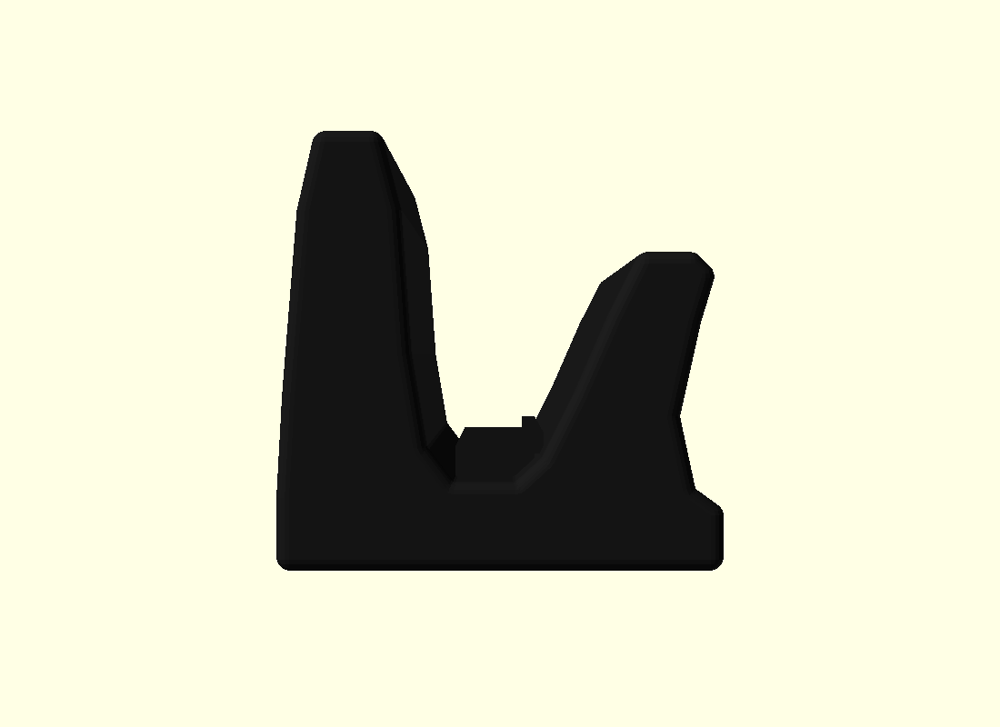
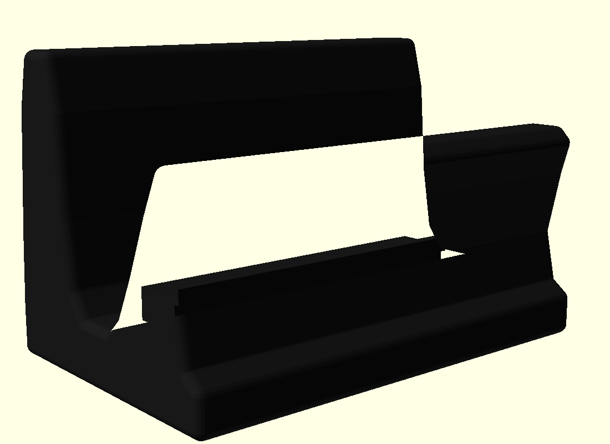
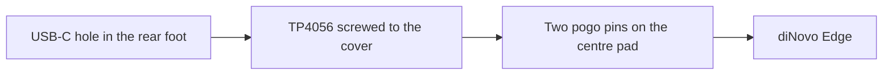

# Logitech diNovo Edge — 3D-printable charging cradle

A one-piece stand shaped like the factory cradle, sized to the published envelope **135 × 87 × 85.5 mm** (width × depth × height). The keyboard leans in the slot between a tall rear fin and a shorter front fin. Two pogo pins land on the centre contact pad. A TP4056 board screws to the bottom cover, and its USB-C plug goes through a hole in the rear of the foot.





## What you get

| Path | Purpose |
|------|---------|
| [`openscad/dinovo_cradle.scad`](openscad/dinovo_cradle.scad) | Parametric model |
| [`stl/dinovo_cradle.stl`](stl/dinovo_cradle.stl) | The stand |
| [`stl/dinovo_cradle_cover.stl`](stl/dinovo_cradle_cover.stl) | Bottom cover with the four TP4056 bosses |
| [`docs/CALIBRATION.md`](docs/CALIBRATION.md) | Measure the contacts before the final print |
| [`docs/ELECTRONICS.md`](docs/ELECTRONICS.md) | USB-C, the TP4056, and the factory 8 V dock |
| [`docs/PRINTING.md`](docs/PRINTING.md) | Slicer notes |
| [`docs/ASSEMBLY.md`](docs/ASSEMBLY.md) | Pins, board, cover |
| [`bom.csv`](bom.csv) | Parts |



## Shape

The factory stand is a glossy black plinth with two fins. This model follows that side profile: tall rear fin, shorter front fin, rounded crests, and a foot that runs the full depth. The centre pad is slightly narrower than the keyboard’s bottom cutout (about 102 mm), with a lip so the keyboard cannot slide forward. Overall size is the published stand size, so the 409 mm keyboard overhangs both sides the way it does on the original.

## TP4056 and the USB-C hole

The bottom cover has **four M2 mounting holes** on bosses. Defaults match a common **38 × 22 mm** USB-C TP4056 with four holes about **3 mm** in from each edge (32 × 16 mm pitch). The USB-C opening in the rear face is **13.5 × 7.4 mm**, in line with that board’s receptacle.

Measure your own board before printing. Edit `BOARD_L`, `BOARD_W`, `HOLE_INSET_L`, and `HOLE_INSET_W` in the OpenSCAD file if the pitch differs. A smaller board with no holes will not pick up these screws; set the outline to that board or glue it in the bay.

The factory dock feeds the keyboard **8 V, 500 mA**. A TP4056’s battery terminals are **4.2 V**. See [ELECTRONICS.md](docs/ELECTRONICS.md) before wiring the pins.

## Quick start

```bash
./scripts/export-stl.sh
```

OpenSCAD parts: `cradle`, `cover`, `assembly` (stand plus a ghost keyboard), `exploded`.

## License

Hardware and documentation in this repository are provided as-is for personal use. Logitech and diNovo are trademarks of their respective owners.
