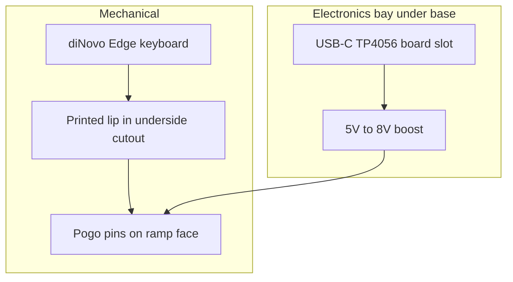

# Logitech diNovo Edge — 3D-printable USB-C charging cradle

Open-source mechanical design for a replacement charging stand shaped like the **factory Logitech dock** (tall rear wall, short front lip, centre slot/fold), with **spring pogo pins**, **USB-C** access, and a **TP4056-class** bay (with documented power architecture).

## What you get

| Path | Purpose |
|------|---------|
| [`openscad/dinovo_cradle.scad`](openscad/dinovo_cradle.scad) | Parametric CAD — lip, pins, electronics bay |
| [`stl/`](stl/) | Pre-exported STLs (split: `side_left`, `side_right`, `center`, or one-piece `cradle`) |
| [`docs/ASSEMBLY.md`](docs/ASSEMBLY.md) | Glue/peg assembly for split prints |
| [`docs/CALIBRATION.md`](docs/CALIBRATION.md) | How to measure contacts and tune OpenSCAD |
| [`docs/ELECTRONICS.md`](docs/ELECTRONICS.md) | USB-C, TP4056 bay, **8 V boost** to pogo pins |
| [`docs/PRINTING.md`](docs/PRINTING.md) | Slicer settings and build order |
| [`bom.csv`](bom.csv) | Parts list |

## Design overview

The model is a **single sculpted monolith** (~158 mm wide): a **narrow slot** between the front lip and tall rear wall holds the keyboard’s 12 mm edge; the **centre fold** engages the underside cutout (~102 × 38 mm) with hook retention and pogo pins. The rear **foot overhang** matches the OEM base and hides the USB-C / TP4056 cavity underneath.



**Important:** The factory dock supplies **8 V, 500 mA**, not 4.2 V. Reserve the TP4056 for USB-C breakout / 5 V distribution and use a small boost converter to the pogo pins (see [ELECTRONICS.md](docs/ELECTRONICS.md)).

## Quick start

```bash
# Regenerate STLs after editing parameters
./scripts/export-stl.sh
```

1. Read [CALIBRATION.md](docs/CALIBRATION.md) and measure your keyboard.
2. Edit `CONTACT_SPACING`, `CONTACT_HEIGHT`, and lip dimensions in `openscad/dinovo_cradle.scad`.
3. Print `stl/dinovo_cradle_base.stl` and dry-fit before printing the back panel.
4. Wire per [ELECTRONICS.md](docs/ELECTRONICS.md); verify **8 V** at pins before mating the keyboard.

## OpenSCAD parts

Pass `-D 'PART="..."'` when exporting:

- `side_left` / `side_right` — outer side walls  
- `center` — rear, front lip, fold, pogo pins, pegs  
- `cradle` — one-piece monolith (all of the above)  
- `electronics_cover` — underside bay lid  
- `assembly` — full preview with ghost keyboard (default)

## License

Hardware and documentation in this repository are provided as-is for personal use. Logitech and diNovo are trademarks of their respective owners.