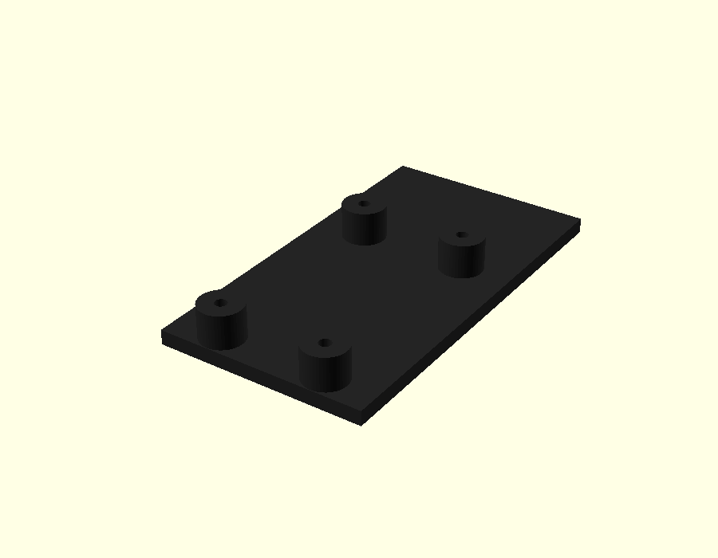

# Assembly

1. Solder a wire to each pogo-pin tail. Use a straight **1.5 mm × 16 mm** pin.
2. Drop each pin into a slot on the centre pad, tail downward. Push until the sleeve stops. About 2.6 mm of tip should stand above the pad. Slide the pin along the slot so it will meet the keyboard contact.
3. Route both wires into the bay under the pad.
4. Screw the TP4056 to the cover, USB-C toward the rear edge of the cover. Connect the two wires to the board’s output pads.
5. Fit the cover into the foot and screw it down. A USB-C cable should pass through the rear hole and seat in the board.
6. Set the keyboard into the slot. The centre pad enters the bottom recess, the lip stops it sliding forward, and the pins compress against the contacts.

